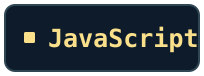
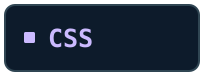
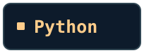
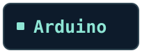
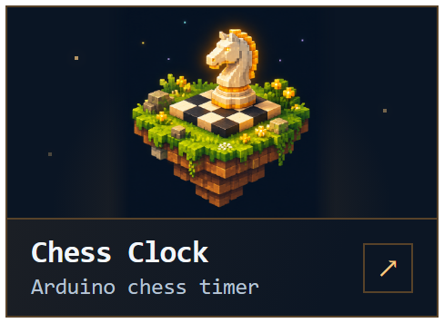
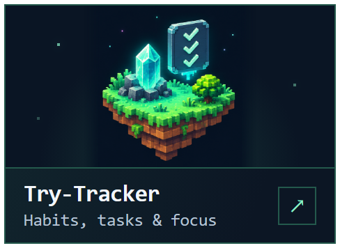
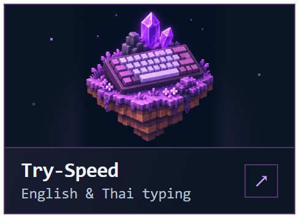

  <picture>
    <source media="(max-width: 600px) and (prefers-reduced-motion: reduce)" srcset="assets/terminal/hero-mobile-still.svg">
    <source media="(prefers-reduced-motion: reduce)" srcset="assets/terminal/hero-still.svg">
    <source media="(max-width: 600px)" srcset="assets/terminal/hero-mobile.svg">
    
  </picture>

<h2><code>$ ./island-map</code></h2>

  <picture>
    <source media="(max-width: 600px) and (prefers-reduced-motion: reduce)" srcset="assets/terminal/roadmap-mobile-still.svg">
    <source media="(prefers-reduced-motion: reduce)" srcset="assets/terminal/roadmap-still.svg">
    <source media="(max-width: 600px)" srcset="assets/terminal/roadmap-mobile.svg">
    
  </picture>

<h2><code>$ cat toolkit.txt</code></h2>

  
  
  
  
  
  

<h2><code>$ ls ~/projects</code></h2>

  
  
  

<h2><code>$ open ./learning-lab</code></h2>

<table>
  <thead><tr><th>Repository</th><th>What’s inside</th></tr></thead>
  <tbody>
    <tr><td><a href="https://github.com/trynabe/python-coding-exercises">Python Coding Exercises</a></td><td>Programming fundamentals, functions, and file I/O</td></tr>
    <tr><td><a href="https://github.com/trynabe/python-calculator">Python Calculator</a></td><td>A small calculator project for practicing unit tests</td></tr>
  </tbody>
</table>

<h2><code>$ tail ./activity</code></h2>

  <a href="https://github.com/trynabe#contributions">
    <picture>
      <source media="(prefers-reduced-motion: reduce)" srcset="assets/terminal/activity-link.svg">
      
    </picture>
  </a>

