  <a href="https://trynabe.github.io/trynabe/sky-island.html#banner" title="Open full-size Sky Island banner">
    <picture>
      <source media="(max-width: 600px) and (prefers-reduced-motion: reduce)" srcset="assets/terminal/hero-mobile-still.svg">
      <source media="(prefers-reduced-motion: reduce)" srcset="assets/terminal/hero-still.svg">
      <source media="(max-width: 600px)" srcset="assets/terminal/hero-mobile.svg">
      
    </picture>
  </a>

<h2><code>$ ls ~/projects</code></h2>

  
  
  

<h2><code>$ tail ./activity</code></h2>

  <a href="https://github.com/trynabe#contributions">
    <picture>
      <source media="(prefers-reduced-motion: reduce)" srcset="assets/terminal/activity-link.svg">
      
    </picture>
  </a>

